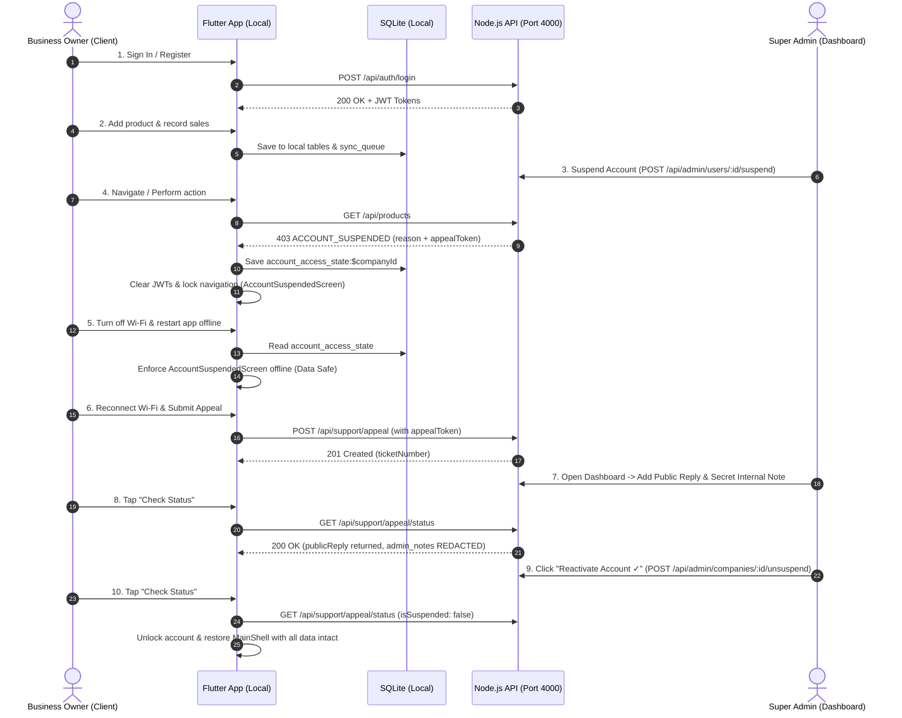

# MODIRI AI — COMPLETE LOCAL TESTING GUIDE & STEP-BY-STEP TESTING MANUAL

> **CONFIDENTIAL & LOCAL DEVELOPMENT USE ONLY**  
> **Target Branch:** `fix/own-backend-deploy`  
> **Environment:** Windows PowerShell • Node.js v24 • Flutter 3.38 • PostgreSQL 18 (Local)

---

## 1. ABSOLUTE SAFETY RULES (MANDATORY)

Before running any command in this guide, ensure strict adherence to these rules:

1. **ZERO PRODUCTION TOUCH:** Never connect to Render, run commands against `smartbiz-db`, or target any remote production database.
2. **NO GIT MUTATIONS:** Do not run `git commit`, `git push`, `git checkout`, `git reset`, or `git clean`. All existing uncommitted changes in `desktop/`, `mobile/`, `backend/`, and configuration files must remain preserved.
3. **NO UNSANCTIONED FLUTTER CLEAN:** Never run `flutter clean` or delete local database files unless specifically instructed after explaining the exact impact.
4. **CREDENTIAL PROTECTION:** Never print or paste full database URLs with passwords, JWT secrets, or API keys into chat or terminal logs.
5. **REAL COMMAND EXECUTION:** Never mark a step as passed without executing the command, capturing the exit code, and reviewing the terminal output.

---

## 2. DISCOVERED ENVIRONMENT & TOOLCHAIN

The repository environment has been inspected on your local machine:

| Component | Discovered Version / Status | Path / Target |
| :--- | :--- | :--- |
| **Operating System** | Windows 10 / 11 (PowerShell) | `Microsoft Windows [version 10.0.26200]` |
| **Git Working Tree** | Branch: `fix/own-backend-deploy` | 51 modified/untracked files preserved |
| **Node.js & npm** | Node `v24.11.1` • npm `11.6.2` | `backend/` |
| **Flutter & Dart** | Flutter `3.38.4` • Dart `3.10.3` | `mobile/` & `desktop/` |
| **PostgreSQL Client**| `psql (PostgreSQL) 18.6` | Available in PowerShell PATH |
| **Local PostgreSQL** | Running on `127.0.0.1:5432` | Verified via TCP loopback test |
| **Available Devices**| Windows Desktop, Chrome, Edge | Android Emulator / Physical Device optional |
| **Backend Target**   | Default Local: `http://localhost:4000` | Local DB: `smartbiz` on `127.0.0.1:5432` |

---

## 3. PHASE A — ENVIRONMENT & REPOSITORY SANITY CHECKS

### Step A.1: Verify Git Working Tree
* **Terminal:** Terminal 1 (PowerShell)
* **Directory:** Repository Root (`modiri-business-type-simplified (1)`)
* **Command:**
  ```powershell
  git status --short
  ```
* **Purpose:** Ensures your local uncommitted changes are intact and you are on `fix/own-backend-deploy`.
* **Expected Output:** Lists modified files (`M`) and untracked files (`??`) without errors.
* **Failure Handling:** If Git reports fatal errors, stop immediately; do not run any reset commands.

---

### Step A.2: Verify Toolchain Availability
* **Terminal:** Terminal 1 (PowerShell)
* **Directory:** Repository Root
* **Command:**
  ```powershell
  node -v; npm -v; flutter --version; psql --version
  ```
* **Purpose:** Confirms all compilers, package managers, and database tools are recognized.
* **Expected Output:**
  ```text
  v24.11.1
  11.6.2
  Flutter 3.38.4 ... Dart 3.10.3
  psql (PostgreSQL) 18.6
  ```

---

### Step A.3: Verify Local PostgreSQL Service
* **Terminal:** Terminal 1 (PowerShell)
* **Directory:** Repository Root
* **Command:**
  ```powershell
  Test-NetConnection -ComputerName 127.0.0.1 -Port 5432
  ```
* **Purpose:** Verifies that your local PostgreSQL service is active on the default port.
* **Expected Output:** `TcpTestSucceeded : True`
* **If Failed (`TcpTestSucceeded : False`):** Start your local PostgreSQL service from Windows Services (`services.msc` -> `postgresql-x64-18` -> Start).

---

## 4. PHASE B — BACKEND AUTOMATED TESTS

All backend tests execute in an isolated environment against your local database without touching production.

### Step B.1: Verify Backend Dependencies
* **Terminal:** Terminal 1 (PowerShell)
* **Directory:** `backend`
* **Command:**
  ```powershell
  cd "c:\Users\Haoui\Downloads\modiri-business-type-simplified (1)\backend"
  npm list --depth=0
  ```
* **Purpose:** Verifies required Node.js modules (`jest`, `pg`, `bcryptjs`, `jsonwebtoken`, `express`) are present.
* **Expected Output:** Lists project dependencies without missing package errors.

---

### Step B.2: Run Dedicated Suspension, Appeal & Trial Enforcement Test Suite
* **Terminal:** Terminal 1 (PowerShell)
* **Directory:** `backend`
* **Command:**
  ```powershell
  npx jest src/__tests__/suspension_trial_appeal_enforcement.test.js --runInBand
  ```
* **What this tests:**
  1. Instant mid-session rejection of existing access JWTs upon account suspension.
  2. Blocking login and refresh token issuance for suspended users.
  3. Strict boundary isolation: `appealToken` cannot access business or administrative APIs.
  4. Server-side binding of appeal ticket identity (ignoring spoofed tenant IDs).
  5. **Confidentiality separation:** User receives `publicReply`; internal `admin_notes` are strictly redacted.
  6. Instant access restoration when Super Admin reactivates the company.
  7. Trial and temporary license expiration blocking business APIs while keeping renewal routes accessible.
  8. Lifetime licenses and paid subscriptions exempt from expiration locks.
* **Expected Output:**
  ```text
  PASS src/__tests__/suspension_trial_appeal_enforcement.test.js
  Tests: 19 passed, 19 total
  Exit code: 0
  ```

---

### Step B.3: Run the Complete Backend Test Suite
* **Terminal:** Terminal 1 (PowerShell)
* **Directory:** `backend`
* **Command:**
  ```powershell
  npm test -- --runInBand
  ```
* **Purpose:** Confirms all 28 backend test suites (332 total tests) across billing, licensing, restaurant, offline sync, auth, and AI pass without regression.
* **Expected Output:**
  ```text
  Test Suites: 28 passed, 28 total
  Tests:       332 passed, 332 total
  Snapshots:   0 total
  Time:        ~12 s
  ```

---

## 5. PHASE C — SAFE LOCAL POSTGRESQL & MIGRATION TESTING

> [!IMPORTANT]
> Never run migrations against Render. These commands only target `localhost:5432`.

### Step C.1: Verify Local Database Target Safely
* **Terminal:** Terminal 1 (PowerShell)
* **Directory:** `backend`
* **Command:**
  ```powershell
  node -e "const env = require('./src/config/env'); const u = new URL(env.databaseUrl); console.log('Target Host:', u.hostname, '| DB Name:', u.pathname.replace(/^\//, '')); if (u.hostname !== 'localhost' && u.hostname !== '127.0.0.1') { console.error('FATAL: Not targeting local host!'); process.exit(1); }"
  ```
* **Expected Output:** `Target Host: localhost | DB Name: smartbiz`

---

### Step C.2: Inspect `support_messages` Schema for `public_reply`
* **Terminal:** Terminal 1 (PowerShell)
* **Directory:** `backend`
* **Command:**
  ```powershell
  node -e "const { query } = require('./src/config/db'); query(\"SELECT column_name, data_type FROM information_schema.columns WHERE table_name = 'support_messages' AND column_name IN ('public_reply', 'admin_notes')\").then(r => { console.table(r.rows); process.exit(0); }).catch(e => { console.error(e); process.exit(1); });"
  ```
* **Expected Output:**
  ```text
  ┌─────────┬──────────────┬───────────┐
  │ (index) │ column_name  │ data_type │
  ├─────────┼──────────────┼───────────┤
  │    0    │ 'admin_notes'│   'text'  │
  │    1    │'public_reply'│   'text'  │
  └─────────┴──────────────┴───────────┘
  ```

---

### Step C.3: Verify Migration Script Integrity
* Migration `034_create_subscriptions_licensing_payments.sql` creates the baseline subscription and support tables.
* Migration `035_add_public_reply_to_support_messages.sql` adds the `public_reply` column defensively (`ADD COLUMN IF NOT EXISTS`).
* Run the migration runner against local DB:
  ```powershell
  node run_migrations.js
  ```
* **Expected Output:** Reports migrations checked and up-to-date with advisory lock released.

---

## 6. PHASE D — FLUTTER MOBILE TESTING

### Step D.1: Check Dependencies & Static Analysis
* **Terminal:** Terminal 1 (PowerShell)
* **Directory:** `mobile`
* **Command:**
  ```powershell
  cd "c:\Users\Haoui\Downloads\modiri-business-type-simplified (1)\mobile"
  flutter analyze
  ```
* **Purpose:** Verifies that all Dart code is syntactically sound, type-safe, and free of lint errors.
* **Expected Output:** `No issues found! (ran in ~10s)`

---

### Step D.2: Run Suspension, Offline Lock & Data Preservation Tests
* **Terminal:** Terminal 1 (PowerShell)
* **Directory:** `mobile`
* **Command:**
  ```powershell
  flutter test test/suspension_trial_offline_lock_test.dart test/widget_test.dart
  ```
* **What this tests:**
  1. Mid-session lock: server suspension error immediately transitions session and stores durable SQLite record.
  2. Sync engine safety: sync halts on suspension without deleting offline records or incrementing retry count.
  3. Cold offline restart: app launch while 100% offline restores suspension lock from SQLite.
  4. Multi-account isolation: switching to Company B preserves Company A local business records and sync queue.
  5. UI widgets: `AccountSuspendedScreen` and `TrialExpiredScreen` display correct reasons and non-dismissible `PopScope`.
* **Expected Output:**
  ```text
  All tests passed!
  ```

---

### Step D.3: Run Complete Core Mobile Test Suite
* **Terminal:** Terminal 1 (PowerShell)
* **Directory:** `mobile`
* **Command:**
  ```powershell
  flutter test --concurrency=1 test/suspension_trial_offline_lock_test.dart test/subscription_and_licensing_flow_test.dart test/clear_application_data_test.dart test/widget_test.dart
  ```
* **Expected Output:** `All tests passed!` (30/30 tests)

---

## 7. PHASE E — LOCAL INTEGRATION TESTING (FULL STACK)

### Step E.1: Start Local Backend Server
* **Terminal:** Terminal 1 (PowerShell)
* **Directory:** `backend`
* **Command:**
  ```powershell
  npm run dev
  ```
* **Expected Output:**
  ```text
  [HTTP] Server listening on port 4000 in development mode
  [DB] Connected to PostgreSQL
  ```
* Keep this terminal window open.

---

### Step E.2: Point Mobile / Desktop App to Local Backend

The app supports dynamic API URL resolution via `ApiClient.defaultBaseUrl`:

| Platform / Device | Default Target | Launch Command / Flag |
| :--- | :--- | :--- |
| **Windows Desktop** | `http://127.0.0.1:4000/api` | `flutter run -d windows` |
| **Web (Chrome)** | `http://127.0.0.1:4000/api` | `flutter run -d chrome` |
| **Android Emulator** | `http://10.0.2.2:4000/api` | `flutter run -d <emulator-id>` |
| **Physical Android Phone** | `http://<YOUR_PC_IP>:4000/api` | `flutter run -d <device-id> --dart-define=API_URL=http://<YOUR_PC_IP>:4000/api` |

> **Finding your PC Local IP (for physical Android device):**  
> Run `ipconfig` in PowerShell and look for `IPv4 Address` (e.g., `192.168.1.15`). Ensure your phone is on the same Wi-Fi network and Windows Defender Firewall allows inbound traffic on TCP port 4000.

---

## 8. PHASE F — STEP-BY-STEP MANUAL SUSPENSION & APPEAL TEST SCENARIO

Execute this manual testing flow on Windows desktop, Chrome, or your Android device:



### Detailed Manual Verification Checklist:

| Step # | User Action | Expected System Behavior | Verification Status |
| :---: | :--- | :--- | :---: |
| **1** | Open local app, sign in or register new tenant | Lands on Dashboard, status is active. | [ ] |
| **2** | Add a test product (e.g., "Test Juice") | Product appears in inventory and local SQLite. | [ ] |
| **3** | In browser, open `http://localhost:4000/admin` | Logs into Super Admin dashboard. | [ ] |
| **4** | Locate test user -> Click "تعليق الحساب" | Prompts for required reason ($\ge 3$ chars). Enter: *"Audit verification"*. | [ ] |
| **5** | Return to Flutter app -> Tap any business tab | Instantly switches to `AccountSuspendedScreen`. Back button is blocked. | [ ] |
| **6** | Verify screen text | Displays: *"Reason: Audit verification"* and *"Your store data is safe"*. | [ ] |
| **7** | Kill app process, turn on Airplane mode / disconnect internet, launch app cold | Opens directly into `AccountSuspendedScreen`. No white/black screen. | [ ] |
| **8** | Reconnect internet -> Fill out appeal form ($\ge 10$ chars) | Submit appeal -> Receives ticket ID (e.g. `APL-...`). Form hides. | [ ] |
| **9** | In Admin Dashboard -> "تذاكر الدعم وطلبات المراجعة" | Appeal appears. Click "الرد / تدوين ملاحظات". | [ ] |
| **10**| Enter Public Reply: *"Please verify phone"*, Internal Note: *"SECRET INVESTIGATION"* | Saves response. Status updates to `answered` or `in_progress`. | [ ] |
| **11**| In Flutter app -> Tap "Check Status / التحقق من الحالة" | Shows Public Reply in green. **"SECRET INVESTIGATION" is completely absent**. | [ ] |
| **12**| In Admin Dashboard -> Click "إعادة تفعيل الحساب ✓" | Company suspension is removed in database. | [ ] |
| **13**| In Flutter app -> Tap "Check Status / التحقق من الحالة" | Shows *"Your account has been reactivated!"* and navigates to Dashboard. | [ ] |
| **14**| Check inventory in Flutter app | "Test Juice" is still present and intact! Zero data was deleted. | [ ] |

---

## 9. PHASE G — PRIVACY, MIGRATION & SECURITY CHECKS

1. **Internal Notes Confidentiality:** Confirmed by automated backend test `Suspended user receives user-facing publicReply while internal admin notes and privileged metadata are strictly redacted`.
2. **Token Boundary Integrity:** Confirmed by test `Narrowly scoped appealToken is rejected with 401 on all business and refresh endpoints`.
3. **No Local Bypass:** Local client clears access tokens upon suspension; SQLite `sync_metadata` prevents offline bypass.
4. **Data Preservation:** Sync engine loop breaks gracefully on HTTP 403 without incrementing retries or deleting records from `sync_queue`.

---

## 10. PHASE H — DESKTOP TESTING (IF APPLICABLE)

* **Directory:** `desktop`
* **Static Analysis:**
  ```powershell
  cd "c:\Users\Haoui\Downloads\modiri-business-type-simplified (1)\desktop"
  flutter analyze
  ```
* **Automated Tests:**
  ```powershell
  flutter test test/business_workflows_test.dart test/crud_workflows_test.dart
  ```
* **Local Run:**
  ```powershell
  flutter run -d windows
  ```
